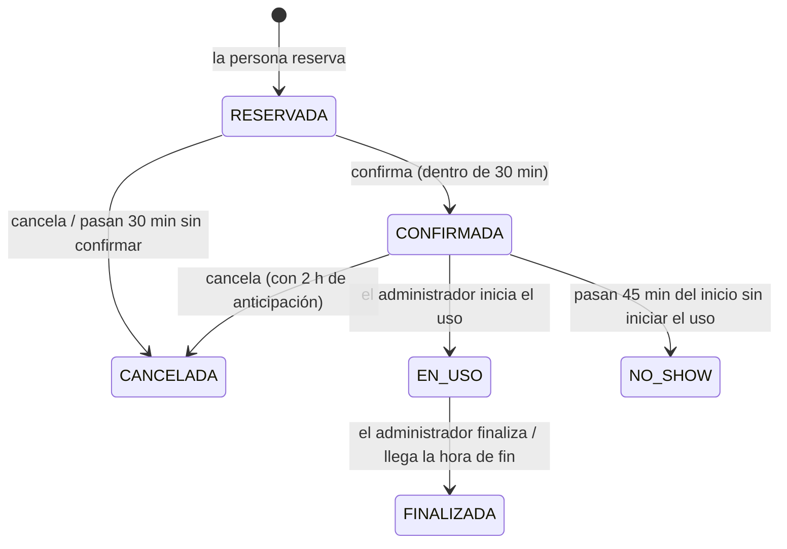

# 🌿 Sistema de Reserva de Espacios Compartidos

Aplicación web para **reservar salas, auditorios, canchas y áreas recreativas** sin que dos personas se crucen en el mismo horario.
Cada persona se registra, mira en un calendario qué espacios están libres, reserva, confirma y recibe avisos por mensaje de texto
(SMS) o correo. Los administradores gestionan los espacios y los usuarios, marcan el uso de las reservas y ven reportes.

Proyecto de Ingeniería del Software — Universidad Industrial de Santander (UIS), Grupo 4 - Aura Lovers.

---

## Contenido

1. [¿Qué puede hacer?](#1-qué-puede-hacer)
2. [Tecnologías](#2-tecnologías)
3. [Cómo ejecutarlo](#3-cómo-ejecutarlo)
4. [Primer recorrido (para probarlo)](#4-primer-recorrido-para-probarlo)
5. [Cómo funciona una reserva](#5-cómo-funciona-una-reserva)
6. [Notificaciones](#6-notificaciones)
7. [Recuperar la contraseña](#7-recuperar-la-contraseña)
8. [Configuración (correo, SMS y otros)](#8-configuración-correo-sms-y-otros)
9. [Estructura del proyecto](#9-estructura-del-proyecto)
10. [Seguridad](#10-seguridad)
11. [Pruebas](#11-pruebas)


---

## 1. ¿Qué puede hacer?

Hay dos tipos de personas (roles): **usuario** y **administrador**.

### Usuario
- **Registrarse** (hay que aceptar la política de tratamiento de datos) e iniciar sesión. La sesión se cierra sola tras 30 minutos sin actividad.
- **Ver el calendario de disponibilidad** por día, semana o mes, filtrando por tipo de espacio y por franja horaria
  (todo el día, mañana 6:00–12:00, tarde 12:00–18:00, noche 18:00–24:00). Cada casilla aparece como libre, reservada o bloqueada
  (horario que ya pasó). Se actualiza solo cada 3 segundos.
- **Reservar un espacio**: elige espacio, fecha, hora de inicio y hora de fin. 
- **Confirmar, editar o cancelar** sus reservas desde *Mis reservas*.
- **Mi perfil**: editar nombre, teléfono y contraseña; elegir **cómo quiere recibir las notificaciones** (SMS, correo o ninguna);
  y ver el **historial** de todas sus reservas.
- **Recuperar su contraseña** por correo si la olvidó.

### Administrador
Todo lo anterior, más:
- **Espacios**: crear, editar y eliminar espacios (nombre, tipo, capacidad, ubicación).
  Eliminar es “lógico”: el espacio desaparece de las listas pero su historial se conserva, y solo se permite si no tiene reservas futuras activas.
- **Uso de reservas**: marcar cuándo una reserva *empieza a usarse* (el espacio pasa a ocupado) y cuándo *termina*.
  Se abre desde la tarjeta correspondiente en la pantalla de inicio.
- **Usuarios**: ver usuarios, cambiarles el rol, activarlos o desactivarlos, y cancelar reservas de otras personas.
  Siempre debe quedar al menos un administrador activo.
- **Reportes**: total de reservas, horas reservadas, ocupación por espacio y reservas por estado, filtrables por fechas, espacio y tipo.

---

## 2. Tecnologías

| Qué | Para qué |
|---|---|
| **Java 21** | Lenguaje |
| **Spring Boot 3.3.5** | Marco de la aplicación (web, seguridad, base de datos, correo, validación) |
| **Thymeleaf** | Páginas HTML generadas en el servidor |
| **Spring Security** | Inicio de sesión, roles y protección de rutas |
| **Spring Data JPA + Hibernate** | Acceso a la base de datos |
| **H2** (base de datos en archivo) | Guarda los datos sin instalar nada |
| **JavaMail** | Envío de correos |
| **Twilio** (API REST, opcional) | Envío de SMS reales |
| **JUnit 5 + Mockito** | Pruebas |
| **Maven** | Compilación y dependencias |

El navegador solo usa HTML, CSS y dos archivos de JavaScript propios (`calendario.js` y `hora12.js`).

---

## 3. Cómo ejecutarlo

### Requisitos
- **JDK 21** (Java 21).
- **Maven** (viene incluido en IntelliJ IDEA).
- Conexión a internet la primera vez, para descargar las dependencias.

No hay que instalar ninguna base de datos ni ningún servidor: todo corre incluido.

### Opción A — IntelliJ IDEA Community (la más fácil)
1. Instala **IntelliJ IDEA Community** (jetbrains.com/idea/download).
2. `File > Open` y elige la carpeta del proyecto (la que contiene `pom.xml`). Espera a que termine de descargar dependencias (barra inferior).
3. Si pide un JDK: `File > Project Structure > SDK > Download JDK` y elige la versión **21**.
4. Abre `src/main/java/co/edu/uis/reservas/ReservasApplication.java` y pulsa el botón verde ▶ junto a `main`.
5. Entra a **http://localhost:8080**.

### Opción B — Terminal
Con JDK 21 y Maven instalados:

```bash
mvn spring-boot:run
```

---

## 4. Primer recorrido (para probarlo)

La primera vez, el sistema crea solo:
- Un **administrador**: `admin@reservas.co` / `Admin1234`
- Cuatro **espacios de ejemplo**: Sala Guadua (sala de reuniones), Auditorio Roble, Cancha Ceiba y Kiosco del Jardín (área recreativa con tarifa).


1. Abre http://localhost:8080 e inicia sesión con el administrador, o crea tu cuenta en **Regístrate**.
2. En el **inicio** verás “Hola, *tu nombre*” y tarjetas con los accesos principales.
3. Entra al **Calendario**, elige un espacio libre y haz clic en una casilla: te lleva al formulario con la fecha y la hora ya puestas.
4. En **Nueva reserva** confirma espacio, fecha, hora de inicio y de fin (con a. m. / p. m.) y guarda.
   La reserva queda en estado **RESERVADA**.
5. En **Mis reservas** pulsa **Confirmar** (tienes 30 minutos; si no, el sistema la libera sola).
6. Mira la consola donde corre la aplicación: verás el aviso simulado, por ejemplo
   `[SMS simulado] a +573001234567: Reservas UIS: Tu reserva en «Sala Guadua» …`.
7. Entra a **Mi perfil → Notificaciones** y prueba cambiar entre SMS, correo o ninguna.
8. Como administrador, prueba **Espacios**, **Usuarios**, la tarjeta de **uso de reservas** del inicio y **Reportes**.

---

## 5. Cómo funciona una reserva

### Estados



| Estado | Significado |
|---|---|
| `RESERVADA` | Creada, falta confirmarla. **Ya bloquea el horario.** |
| `CONFIRMADA` | La persona la confirmó. |
| `EN_USO` | Llegó la hora y el administrador marcó el espacio como ocupado. |
| `FINALIZADA` | Terminó el uso. |
| `CANCELADA` | Cancelada por la persona, por un administrador, o liberada por no confirmarla a tiempo. |
| `NO_SHOW` | La persona no llegó (inasistencia). |

Las reservas en `RESERVADA`, `CONFIRMADA` y `EN_USO` **bloquean** el horario: nadie más puede reservar un horario que se cruce con ellas.
Solo se pueden editar o cancelar reservas `RESERVADA` o `CONFIRMADA`.

### Reglas de negocio

| Regla | Valor |
|---|---|
| Horas de inicio y fin | Solo en punto o y media |
| Duración mínima | 30 minutos |
| Duración máxima | 4 horas |
| Tiempo para confirmar una reserva `RESERVADA` | 30 minutos (después se cancela sola) |
| Anticipación para cancelar una reserva `CONFIRMADA` | Al menos 2 horas antes del inicio |
| Recordatorio antes de la reserva | 24 horas antes |
| Recordatorio “el espacio no se ha marcado como ocupado” | 15 minutos después del inicio |
| Inasistencia (`NO_SHOW`) | 30 minutos después del inicio, si no se inició el uso |
| Reintentos al enviar una notificación | 3 |
| Otras | No se reserva en el pasado, ni cruzando horario con otra reserva activa, ni en espacios eliminados |

**Todos estos valores están en un solo archivo:** `src/main/java/co/edu/uis/reservas/config/ReglasNegocio.java`.


### Tareas automáticas
Dos tareas programadas corren solas mientras la aplicación está encendida:

| Tarea | Cada cuánto | Qué hace |
|---|---|---|
| `ReservasScheduler` | 1 minuto | Libera reservas sin confirmar, envía el recordatorio de “sin ocupar”, marca inasistencias y finaliza reservas cuyo horario terminó |
| `RecordatorioScheduler` | 5 minutos | Envía el recordatorio de 24 horas antes a las reservas confirmadas |

---

## 6. Notificaciones

### ¿Cuándo se envía un aviso?
| Evento | Tipo |
|---|---|
| La reserva se confirma | Confirmación |
| La reserva se edita (cambia horario o espacio) | Modificación |
| La reserva se cancela, o se libera por no confirmarla | Cancelación |
| Falta 24 horas para la reserva | Recordatorio |
| Pasaron 15 minutos del inicio y el espacio no se marcó como ocupado | Recordatorio (se envía una sola vez) |

### ¿Por qué canal?
Cada persona elige en **Mi perfil → Notificaciones**:
- **Mensaje de texto (SMS)** al teléfono registrado. Si no tiene un teléfono válido no se le deja guardar esta opción
  (y si después el teléfono deja de ser válido, el aviso va por correo).
- **Correo electrónico.**
- **No quiero recibir notificaciones:** no se envía ni se guarda nada.

Cada intento queda registrado en la tabla `notificaciones` (a quién, canal, tipo, texto, si se envió o falló).
Si un envío falla se reintenta hasta 3 veces, y un fallo **nunca** impide hacer la reserva.

### Modo simulado y modo real
Por defecto **nada sale realmente**: los SMS y los correos solo se escriben en la consola. Es lo ideal para desarrollar y probar.
Para enviar de verdad, mira [Configuración](#8-configuración-correo-sms-y-otros).

---

## 7. Recuperar la contraseña

1. En el login, pulsa **“¿Olvidaste tu contraseña?”**.
2. Escribe el correo de la cuenta. Primero se verifica que esté **asociado a una cuenta activa**; si no, la pantalla lo avisa y no se envía nada.
3. Se envía un correo con un **enlace de un solo uso que vence en 1 hora**.
4. El enlace abre una pantalla para escribir la contraseña nueva (mínimo 8 caracteres, con al menos una letra y un número).
5. Al guardar, el enlace deja de servir y se vuelve al login.

Detalles de seguridad: el enlace lleva un código aleatorio de 256 bits y en la base de datos solo se guarda su *hash* (SHA-256), nunca el código;
cada solicitud nueva invalida las anteriores; y hay una espera de 1 minuto entre solicitudes de la misma cuenta.
Este correo se envía siempre, aunque la persona haya desactivado las notificaciones de reservas.

En **modo simulado**, el enlace aparece en la consola: `[CORREO simulado] a … Enlace: http://localhost:8080/restablecer?token=…` — cópialo en el navegador.

---

## 8. Configuración (correo, SMS y otros)

Toda la configuración está en **`src/main/resources/application.yml`**. Los valores sensibles se leen de **variables de entorno**
(así las claves no quedan escritas en el código). La sintaxis `${NOMBRE:valor}` significa “usa la variable `NOMBRE`; si no existe, usa `valor`”.

### Variables de entorno

| Variable | Para qué | Valor por defecto |
|---|---|---|
| `NOTIFICACIONES_MODO` | `simulado` (solo consola) o `real` (envía correos) | `simulado` |
| `MAIL_HOST` | Servidor de correo (SMTP) | `smtp.gmail.com` |
| `MAIL_PORT` | Puerto SMTP | `587` |
| `MAIL_USUARIO` | Correo desde el que se envía | vacío |
| `MAIL_CLAVE` | Clave del correo (en Gmail: *contraseña de aplicación*) | vacío |
| `MAIL_REMITENTE` | Dirección “De:” (si se omite usa `MAIL_USUARIO`) | `no-reply@reservas.uis.edu.co` |
| `APP_URL` | Dirección pública de la app, usada en el enlace del correo de recuperación | `http://localhost:8080` |
| `SMS_MODO` | `simulado` (solo consola) | `simulado` |
| `SMS_CODIGO_PAIS` | Código de país para teléfonos escritos sin él | `+57` |

### Cómo ponerlas
- **IntelliJ:** `Run > Edit Configurations > Environment variables`, por ejemplo
  `NOTIFICACIONES_MODO=real;MAIL_USUARIO=micuenta@gmail.com;MAIL_CLAVE=xxxx xxxx xxxx xxxx;SMS_MODO=real;TWILIO_ACCOUNT_SID=AC...;TWILIO_AUTH_TOKEN=...;TWILIO_NUMERO=+1...`
- **Terminal (Linux/Mac):** `NOTIFICACIONES_MODO=real MAIL_USUARIO=... mvn spring-boot:run`
- **Terminal (Windows PowerShell):** `$env:NOTIFICACIONES_MODO="real"; mvn spring-boot:run`

---

## 9. Estructura del proyecto

```
reserva-espacios/
├── pom.xml                          Dependencias y versión de Java (Maven)
├── README.md                        Este archivo
├── data/                            Base de datos H2 (se crea sola; no va a git)
└── src/
    ├── main/
    │   ├── java/co/edu/uis/reservas/
    │   │   ├── ReservasApplication.java     Punto de entrada (botón ▶)
    │   │   ├── config/        Reglas de negocio, datos iniciales, utilidades (horas, teléfonos)
    │   │   ├── controller/    Reciben las peticiones web y devuelven páginas
    │   │   ├── service/       La lógica del sistema (aquí viven las reglas)
    │   │   ├── repository/    Consultas a la base de datos
    │   │   ├── domain/        Entidades: lo que se guarda en la base de datos (y sus enumeraciones)
    │   │   ├── dto/           Formularios (lo que llega desde las pantallas) y sus validaciones
    │   │   ├── scheduler/     Tareas automáticas (recordatorios, liberar, inasistencias)
    │   │   ├── security/      Inicio de sesión, roles y rutas protegidas
    │   │   └── exception/     Errores de reglas de negocio
    │   └── resources/
    │       ├── application.yml            Configuración
    │       ├── templates/                 Páginas HTML (Thymeleaf)
    │       └── static/                    CSS y JavaScript
    └── test/java/...                      Pruebas automáticas
```

### Cómo se organiza el código (arquitectura en capas)
Una petición recorre siempre el mismo camino:

```
Navegador → Controller → Service → Repository → Base de datos
              (pantalla)   (reglas)   (consultas)
```

- El **controller** recibe el formulario, lo valida y llama al servicio.
- El **service** aplica las reglas (horarios, estados, permisos) y dispara las notificaciones.
- El **repository** consulta y guarda en la base de datos.
- Cuando se rompe una regla, el servicio lanza `ReglaNegocioException` y la persona ve un mensaje claro.

---

## 10. Seguridad

- Las **contraseñas** se guardan cifradas con **BCrypt**; nunca en texto plano.
- Todos los formularios están protegidos contra **CSRF** (Spring Security).
- Las rutas `/admin/**` solo las puede abrir un administrador; el resto (salvo las públicas) exige iniciar sesión.
- Un usuario **desactivado** no puede iniciar sesión.
- La sesión caduca tras 30 minutos de inactividad.
- Los enlaces de recuperación son de un solo uso, vencen en 1 hora y no se guardan en claro.
- Las claves de correo y Twilio se leen de variables de entorno.

---

## 11. Pruebas

```bash
mvn test
```

Las pruebas automáticas cubren, entre otras cosas:
- Reglas de horario (solo en punto o y media, duración, medianoche).
- Elección del canal de notificación, reintentos y desactivación de avisos.
- Recordatorio de “sin ocupar” a los 30 minutos (cuándo se envía y cuándo no).
- Recuperación de contraseña (correo no registrado, enlace vencido, enlace de un solo uso).
- Conversión de teléfonos a formato internacional.
- Saludo con el nombre, reportes, calendario y consultas de reservas a la base de datos.
